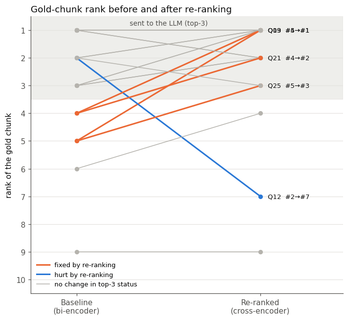
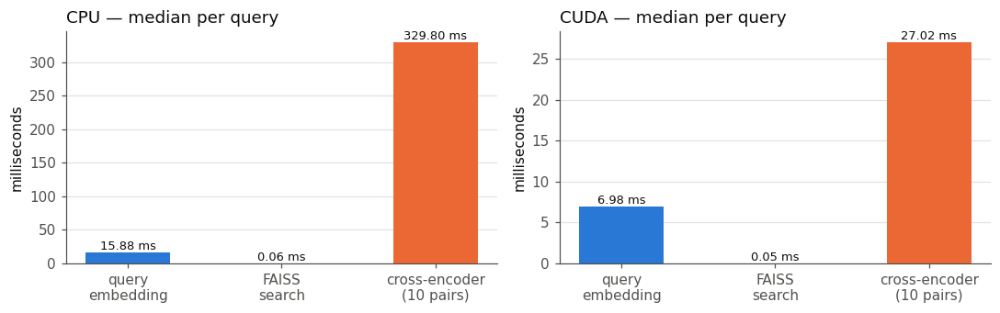
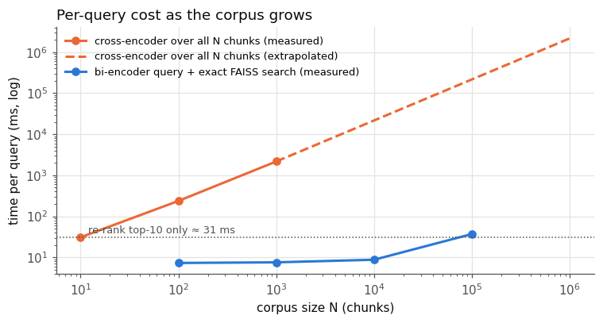

# RAG over the DPDP Act 2023: Baseline Retrieval vs. Cross-Encoder Re-Ranking

This repository builds two retrieval-augmented generation (RAG) pipelines over the same chunked copy of India's
**Digital Personal Data Protection Act, 2023**, and compares them on retrieval quality, final answers, latency and scaling.

| | Pipeline 1: Baseline | Pipeline 2: Re-ranking |
|---|---|---|
| Stage A | bi-encoder (`all-MiniLM-L6-v2`) + FAISS → **top 10** by cosine similarity | the *same* top 10 |
| Stage B | – | cross-encoder (`ms-marco-MiniLM-L-6-v2`) scores all 10 (question, chunk) pairs and re-sorts them |
| Context for the LLM | first 3 of stage A | first 3 after re-sorting |
| Generator | `openai/gpt-oss-120b` (Groq), temperature 0, shared prompt → **Answer 1** | same model and prompt → **Answer 2** |

All code is in one notebook: **`rag_baseline_vs_rerank.ipynb`**.

## Contents
1. [Results at a glance](#results-at-a-glance)
2. [Setup](#setup)
3. [Architecture comparison](#1-architecture-comparison)
4. [Failure-mode analysis and rank shifts](#2-failure-mode-analysis-and-rank-shifts)
5. [Answer 1 vs. Answer 2](#3-answer-1-vs-answer-2)
6. [Latency profiling](#4-latency-profiling)
7. [Scaling question](#5-scaling-question)
8. [All 32 questions](#6-all-32-questions)
9. [Repository layout and how to run](#7-repository-layout-and-how-to-run)

---

## Results at a glance

| | Baseline | Re-ranked |
|---|---|---|
| Hit@1 (correct chunk ranked first) | 0.312 (10/32) | **0.438 (14/32)** |
| Hit@3 (correct chunk reaches the LLM) | 0.562 (18/32) | **0.656 (21/32)** |
| Recall@10 | 0.750 (24/32) | 0.750 (24/32) |
| MRR@10 | 0.453 | **0.552** |
| Correct final answers (checked by hand) | 17/32 | 16/32 |
| Retrieval latency, GPU median | 7.0 ms | 34.1 ms |
| Retrieval latency, CPU median | 15.9 ms | 346.2 ms |

- Re-ranking **moved the correct chunk into the top 3 in 4 questions** (Q09, Q13, Q21, Q25) and **pushed it out in 1** (Q12).
- Retrieval clearly improves, but the final answers come out **about even**: some gains are cancelled by cases where
  re-ranking dropped a useful chunk, or where the LLM refused even though the right chunk was in its context.
- In 8 of 32 questions the correct chunk was **not in the top 10 at all**, which re-ranking cannot fix.
- Re-ranking 10 chunks costs **+27 ms on GPU / +330 ms on CPU**; running the cross-encoder on a million chunks would take **about 36 minutes per question**.

---

## Setup

**Document.** The official Gazette PDF of the DPDP Act, 2023 (21 pages, 44 sections plus a penalty Schedule).
It was chosen because rules, their exceptions and their penalties sit in different places (for example, the duty to
protect data is in Section 8, but the fine is in the Schedule at the end), and because words like *Data Fiduciary* and
*personal data* appear in almost every section, which makes plain vector search struggle.

**Reading the PDF.** PyMuPDF with page coordinates:
- body text is read line by line and joined back into paragraphs (a new paragraph starts on an indented line beginning
  with a legal marker such as `6.`, `(1)`, `(a)` or `Illustration`);
- the 44 section titles are taken from the margin notes;
- running headers, the front-page banner, footer and signature stamp are removed;
- the Schedule is a 3-column table (no. | breach | penalty) and is rebuilt row by row so each fine stays with its rule.

**Chunking.** Structure-aware: sections are split at sub-section and clause boundaries and packed into chunks of at most
**200 tokens** (counted with the bi-encoder's own tokenizer, safely below its 256-token limit). Every chunk starts with
`Section N – Title.` Result: **105 chunks**, 28–198 tokens each.

**Models.**

| Role | Model | Notes |
|---|---|---|
| Bi-encoder | `sentence-transformers/all-MiniLM-L6-v2` | 384-d, mean pooling, L2-normalised; stored in `faiss.IndexFlatIP` (exact cosine search) |
| Cross-encoder | `cross-encoder/ms-marco-MiniLM-L-6-v2` | scores each (question, chunk) pair; reads up to 512 tokens |
| LLM | `openai/gpt-oss-120b` via Groq | temperature 0, low reasoning effort |

**Prompt.** One prompt template is shared by both pipelines. It gives the 3 chunks as numbered extracts `[S1]–[S3]`,
tells the model to use only those extracts, to reply *"The provided extracts do not answer this question."* if they
do not contain the answer, and to cite the extract number after every claim. The question comes last.

**Test set.** 32 questions written in everyday language (Q01–Q20 first, Q21–Q32 added later with the same settings).
Each question has a category, a reference answer with its section, and the chunk(s) that really answer it, marked with
a phrase copied from the Act.

| Category | Questions |
|---|---|
| Exception / penalty elsewhere | Q01–Q07, Q23, Q24, Q26, Q27, Q28, Q30 |
| Negation / constraint | Q08–Q12, Q21, Q29, Q31 |
| Keyword trap / synonym | Q13–Q16, Q22, Q25 |
| Other | Q17–Q20, Q32 |

---

## 1. Architecture comparison

**Bi-encoder.** The question and each chunk are encoded *independently*. The token outputs are mean-pooled into one
384-dimensional vector and L2-normalised, so the inner product in FAISS equals cosine similarity. Because a chunk never
sees the question, every chunk vector is computed once, offline. Answering a question then costs one encoder pass for
the question plus a vector search. The weakness is that each chunk is compressed into a single vector before the question
is known: a rule and its exception, or a "shall" and a "shall not", can land very close together, and a chunk that only
repeats the question's words can rank high without answering it.

**Cross-encoder.** The question and the chunk are fed in *together* as one sequence, `[CLS] question [SEP] chunk [SEP]`.
Self-attention runs jointly over the tokens of both texts in every layer, so each question word can be compared directly
with each chunk word, and a small head on the `[CLS]` output gives one relevance score for the pair. This judges much
better whether a chunk actually answers the question, but nothing can be computed in advance: scoring *N* chunks needs
*N* full transformer passes for every question.

| | Bi-encoder | Cross-encoder |
|---|---|---|
| Input | question and chunk separately | question and chunk together |
| Interaction | none until the final cosine similarity | full attention across both texts |
| Precompute chunk side? | yes, once offline | no |
| Cost per question | 1 encoder pass + vector search | 1 encoder pass per candidate chunk |
| Used here for | first-stage search over all 105 chunks | re-ranking the top 10 |

---

## 2. Failure-mode analysis and rank shifts

The table shows the rank of the correct chunk in each pipeline. Only the top 3 are given to the LLM.

| Question | Failure type | Correct chunk | Baseline → Re-ranked | In top 3? |
|---|---|---|---|---|
| Q09 Must the Data Protection Officer be located in India? | Negation / constraint (role limit) | 36 (s.10(2)) | #5 → **#1** | no → yes |
| Q13 Can I take back my permission after agreeing? | Keyword trap / synonym | 17 (s.6(4)) | #4 → **#1** | no → yes |
| Q21 Can a company refuse service if I won't share data it doesn't need? | Negation / constraint | 14 (s.6(1)) | #4 → **#2** | no → yes |
| Q25 App unused for years, must my data be deleted? | Keyword trap / synonym | 30 (s.8(8)) | #5 → **#3** | no → yes |
| Q01 Maximum fine for weak security? | Exception / penalty elsewhere | 103 (Schedule) | #3 → #1 | yes → yes |
| Q03 Fine for not reporting a breach? | Exception / penalty elsewhere | 103 (Schedule) | #3 → #1 | yes → yes |
| Q27 Must government departments erase my data? | Exception / penalty elsewhere | 52 (s.17(4)) | #6 → #4 | no → no |
| Q12 Can I pretend to be someone else? | Negation / constraint | 45 (s.15) | #2 → #7 | yes → **no** |

**What went wrong in the baseline**
- **Role limit / keyword trap (Q09).** The baseline's top 3 were s.16 (data outside India), s.17(1)
  ("…any person based in India") and s.3 (territory of India). They only share the word *India* with the question.
  The actual rule ("the DPO shall … be based in India") was 5th.
- **Synonyms (Q13, Q25).** "Take back my permission" vs. the Act's "withdraw her consent"; "not used the app for years"
  vs. "does not approach the Data Fiduciary … for such time period as may be prescribed". The baseline returned
  neighbouring chunks about erasure and Consent Managers.
- **Penalty located elsewhere (Q01, Q03).** The duty is in s.8, but the amount is in the Schedule at the end of the Act.
  The baseline ranked the general rule chunks (s.8, s.27, s.33) above the Schedule; the cross-encoder put the Schedule first.
- **Negation / constraint (Q21).** The answer is a limit ("limited to such personal data as is necessary"); the baseline
  returned other consent and erasure chunks.

**Where re-ranking did not help**
- **Q12 (hurt).** The cross-encoder pushed the s.15 duties chunk ("not to impersonate another person") from 2nd to 7th.
  It matched "giving my personal data" with the consent chunks and missed that "pretend to be someone else" means
  "impersonate".
- **Not in the top 10 (8 questions: Q06, Q07, Q11, Q15, Q23, Q26, Q30, Q31).** For example, Q11 asks about suing in a
  civil court (s.39) and Q15 about data rights after death (s.14). Re-ranking only reorders the 10 chunks it is given,
  so these are first-stage failures.

**Retrieval metrics (all 32 questions)**

| Pipeline | Hit@1 | Hit@3 | Recall@10 | MRR@10 |
|---|---|---|---|---|
| Baseline (bi-encoder) | 0.312 | 0.562 | 0.750 | 0.453 |
| Re-ranked (cross-encoder) | **0.438** | **0.656** | 0.750 | **0.552** |

Hit@*k* is the fraction of questions whose correct chunk is in the top *k*; MRR@10 is the mean of 1/rank of the correct
chunk (0 if it is not in the top 10). Recall@10 is identical because both pipelines share the same top 10.

| Outcome | Questions |
|---|---|
| fixed (outside top 3 → inside) | 4 |
| hurt (inside top 3 → outside) | 1 |
| both hit | 17 |
| both miss (in top 10, but not top 3) | 2 |
| not in top 10 | 8 |



---

## 3. Answer 1 vs. Answer 2

Answers are quoted from `results/answers.json`.

**Q09: Must the DPO be located in India?** (correct chunk #5 → #1)
- Answer 1: *"The provided extracts do not answer this question."*
- Answer 2: *"Yes. The Data Protection Officer must be based in India — the Act requires the DPO to 'be based in India' [S1]."*
- The baseline never saw s.10(2), so it refused; the re-ranked context had it first.

**Q13: Can I take back my permission?** (#4 → #1)
- Answer 1: *"Yes. You may withdraw the permission … A Data Principal can give, manage, review or withdraw consent through a
  Consent Manager, and the Data Fiduciary must erase your data once you withdraw consent …"*
- Answer 2: *"Yes. You may withdraw the permission (consent) … at any time, and the withdrawal must be as easy as giving the
  consent [S1] … The withdrawal does not affect the legality of any processing that occurred before …"*
- Answer 1 **left out the essential clause** (any time, as easily as given; earlier processing stays lawful).

**Q21: Can a company refuse service if I won't share data it doesn't need?** (#4 → #2)
- Answer 1: *"The provided extracts do not answer this question."*
- Answer 2: *"… consent must be 'specific … and limited to such personal data as is necessary for such specified purpose' [S2].
  Therefore a data fiduciary may not condition the provision of a service on the sharing of personal data that is not required …"*

**Q25: App unused for years, must my data be deleted?** (#5 → #3)
- Answer 1: *"Yes … a Data Fiduciary must erase personal data when the purpose … is no longer being served … Not having used the
  app for years indicates the original purpose is no longer being served …"*
- Answer 2: *"The provided extracts do not answer this question."*
- Answer 1 guessed from the general erasure rule (s.8(7)) and **missed the actual clause** (s.8(8)). Answer 2 had s.8(8) in
  its context but still refused, so here the weak step was generation, not retrieval.

**Q12: Can I pretend to be someone else?** (#2 → #7, re-ranking hurt)
- Answer 1: *"No. You must not impersonate another person when you provide your personal data … [S2]."*
- Answer 2: *"The provided extracts do not answer this question."*

**Q20: What decides the size of a fine?** (#1 → #1)
- Answer 1 listed all seven factors of s.33(2). Answer 2 listed only five, because re-ranking dropped the following chunk
  that holds factors (f) and (g).

**Manual check of all 64 answers**

| Verdict | Answer 1 (baseline) | Answer 2 (re-ranked) |
|---|---|---|
| Correct | 17 | 16 |
| Refused ("extracts do not answer") | 11 | 13 |
| Omitted an essential clause | 2 | 1 |
| Misstated a rule | 2 | 2 |
| Hallucinated | 0 | 0 |

**Observations**
- When the correct chunk was missing, the baseline mostly **refused** rather than inventing a rule, because the prompt
  allows it to say the extracts do not answer. When it answered anyway, it **omitted a clause** (Q13, Q25) or
  **misstated the rule** (Q26: it said formal consent is still required, but s.7(a) allows voluntarily provided data to
  be used without it).
- Re-ranking fixed the answers where the critical chunk was at rank 4–5 (Q09, Q13, Q21).
- Overall answer accuracy stayed about the same (17 vs. 16). The gains were cancelled by Q12 (chunk pushed out), Q20
  (a needed second chunk dropped), Q18 (context misread) and two refusals with the right chunk in context (Q03, Q25).
  Better ranking helps, but on its own it did not raise end-to-end accuracy, and with 32 questions the difference is small.

---

## 4. Latency profiling

Each stage was timed separately with `time.perf_counter()`: 32 questions × 30 runs, after a warm-up pass, on a laptop
RTX 3050 GPU and on the CPU. LLM time is excluded from the table because it is network time and identical for both
pipelines (median about 5 s per call over 63 calls).

| Stage | GPU median (ms) | GPU p95 (ms) | CPU median (ms) | CPU p95 (ms) |
|---|---|---|---|---|
| Query embedding (bi-encoder) | 6.98 | 8.28 | 15.88 | 19.40 |
| FAISS top-10 search | 0.05 | 0.06 | 0.06 | 0.07 |
| Cross-encoder on 10 pairs | 27.02 | 28.19 | 329.80 | 375.55 |
| **Pipeline 1: baseline retrieval** | **7.03** | 8.33 | **15.95** | 19.46 |
| **Pipeline 2: re-ranking total** | **34.14** | 35.94 | **346.15** | 393.39 |

Re-ranking makes retrieval about **5× slower on the GPU** (+27 ms) and about **22× slower on the CPU** (+330 ms).
Almost all of pipeline 2's time is the cross-encoder; the FAISS search itself is negligible.



---

## 5. Scaling question

*Why not run the cross-encoder over the whole collection from the start?*

A cross-encoder score depends on the question and the chunk together, so nothing can be computed ahead of time. Scoring the
whole collection means one full transformer pass per chunk, for every question, and the cost grows linearly with the
collection size. A bi-encoder embeds every chunk once offline; at question time it encodes only the question and searches
the stored vectors (which an approximate index such as HNSW keeps fast even for millions of vectors).

Measured on the GPU (cross-encoder at 10, 100 and 1,000 pairs, then extrapolated linearly; FAISS exact search over random unit vectors):

| Chunks in collection | Cross-encoder on every chunk | Bi-encoder + FAISS search |
|---|---|---|
| 10 | 31 ms | – |
| 100 | 238 ms | 7.3 ms |
| 1,000 | 2.2 s | 7.6 ms |
| 10,000 | 21.7 s (extrapolated) | 8.8 ms |
| 100,000 | 3.6 min (extrapolated) | 37 ms |
| 1,000,000 | 36 min (extrapolated) | – |



This is why the two are combined: the cheap bi-encoder narrows the collection to a short list (it decides *recall*), and
the expensive cross-encoder only orders those 10 candidates (it decides *precision*). Re-ranking 10 chunks costs about
27 ms; re-ranking a million would take over half an hour per question.

---

## 6. All 32 questions

Rank of the correct chunk (baseline → re-ranked), the retrieval outcome, and the manual verdict for each answer.
Full answers, references and a one-line reason per verdict are in `results/answer_review.csv`.

| ID | Category | Question | Rank | Outcome | Answer 1 | Answer 2 |
|---|---|---|---|---|---|---|
| Q01 | Exception / penalty elsewhere | What is the maximum fine a company can face if weak security leads to a leak of its customers' personal data? | #3 → #1 | both hit | correct | correct |
| Q02 | Exception / penalty elsewhere | How much can an ordinary person be fined for making a fake complaint against a company? | #3 → #2 | both hit | refused | refused |
| Q03 | Exception / penalty elsewhere | What is the penalty for a company that does not report a data breach to the Board? | #3 → #1 | both hit | correct | refused |
| Q04 | Exception / penalty elsewhere | Does this law cover phone numbers I save on my phone for my own personal use? | #9 → #9 | both miss | refused | refused |
| Q05 | Exception / penalty elsewhere | Can a startup skip giving its users a privacy notice? | #1 → #1 | both hit | correct | correct |
| Q06 | Exception / penalty elsewhere | Does a company still need my consent if the police are investigating a crime involving my data? | – → – | not in top 10 | refused | refused |
| Q07 | Exception / penalty elsewhere | Can my data be used without my consent for a research study? | – → – | not in top 10 | refused | refused |
| Q08 | Negation / constraint | Is an app allowed to show personalised ads to a 15-year-old user? | #2 → #1 | both hit | correct | correct |
| Q09 | Negation / constraint | Does a Data Protection Officer have to be located in India? | #5 → #1 | **fixed** | refused | correct |
| Q10 | Negation / constraint | Can a company hand my data to an outside vendor for processing without any contract? | #3 → #2 | both hit | correct | correct |
| Q11 | Negation / constraint | Can I sue a company in a civil court over misuse of my personal data? | – → – | not in top 10 | refused | refused |
| Q12 | Negation / constraint | Am I allowed to pretend to be someone else when giving my personal data to a service? | #2 → #7 | **hurt** | correct | refused |
| Q13 | Keyword trap / synonym | Can I take back my permission after I have agreed to let a company use my data? | #4 → #1 | **fixed** | omitted clause | correct |
| Q14 | Keyword trap / synonym | If hackers steal user data, who does the company have to inform? | #1 → #2 | both hit | correct | correct |
| Q15 | Keyword trap / synonym | What happens to my data rights after I die? | – → – | not in top 10 | refused | refused |
| Q16 | Keyword trap / synonym | Whose permission is needed before a website collects data about a child? | #1 → #1 | both hit | correct | correct |
| Q17 | Other | How many days do I get to appeal against an order of the Data Protection Board? | #1 → #1 | both hit | correct | correct |
| Q18 | Other | Can my personal data be stored on servers in a foreign country? | #1 → #1 | both hit | correct | misstated rule |
| Q19 | Other | How long can a company keep my data after I delete my account? | #1 → #2 | both hit | correct | correct |
| Q20 | Other | What factors does the Board consider when deciding how big a fine should be? | #1 → #1 | both hit | correct | omitted clause |
| Q21 | Negation / constraint | Can a company refuse me a service just because I won't agree to share data it doesn't actually need? | #4 → #2 | **fixed** | refused | correct |
| Q22 | Keyword trap / synonym | Can I ask a company to fix wrong information it holds about me? | #1 → #1 | both hit | correct | correct |
| Q23 | Exception / penalty elsewhere | Can I go straight to the Data Protection Board with a complaint, or do I have to complain to the company first? | – → – | not in top 10 | refused | refused |
| Q24 | Exception / penalty elsewhere | Does the law protect information I have posted publicly on my blog or social media? | #1 → #1 | both hit | correct | correct |
| Q25 | Keyword trap / synonym | If I have not used an app for years, does the company have to delete my data? | #5 → #3 | **fixed** | omitted clause | refused |
| Q26 | Exception / penalty elsewhere | If I send my details to a company myself for a particular purpose, does it still need my formal consent? | – → – | not in top 10 | misstated rule | refused |
| Q27 | Exception / penalty elsewhere | Do government departments also have to erase my data once the purpose is over? | #6 → #4 | both miss | refused | refused |
| Q28 | Exception / penalty elsewhere | Will a company tell me which other organisations it shared my data with, even if it shared it with an investigating agency? | #1 → #1 | both hit | correct | correct |
| Q29 | Negation / constraint | Can the Data Protection Board seize a company's computers during an inquiry? | #2 → #3 | both hit | correct | correct |
| Q30 | Exception / penalty elsewhere | Can my employer use my personal data without asking for my consent? | – → – | not in top 10 | misstated rule | misstated rule |
| Q31 | Negation / constraint | Can the government remove a member of the Data Protection Board without giving them a hearing? | – → – | not in top 10 | refused | refused |
| Q32 | Other | What can the government do if a company keeps getting fined and the Board recommends blocking it? | #2 → #1 | both hit | correct | correct |

---

## 7. Repository layout and how to run

| Path | What |
|---|---|
| `rag_baseline_vs_rerank.ipynb` | the full pipeline: PDF reading, chunking, both pipelines, evaluation, latency and scaling |
| `data/dpdp_act_2023.pdf` | the official Gazette copy of the Act (downloaded automatically if missing) |
| `results/chunks.jsonl` | the 105 chunks with section metadata |
| `results/rank_shift.csv` | per-question rank of the correct chunk in both pipelines and the outcome |
| `results/metrics.csv` | Hit@1, Hit@3, Recall@10, MRR@10 |
| `results/answers.json` | top-3 chunk ids and both answers for every question |
| `results/answer_review.csv` | both answers side by side with the manual verdicts |
| `results/verdict_summary.csv` | verdict counts for Answer 1 vs. Answer 2 |
| `results/latency.csv`, `latency_raw.csv`, `scaling.csv` | timing summaries, raw timings, scaling measurements |
| `results/llm_cache.json` | every LLM answer, keyed by model + exact prompt |
| `results/figures/` | all charts |
| `FLOW.md` | how data moves through the notebook, function by function |

**Run it**
```bash
pip install -r requirements.txt
# free key from https://console.groq.com/keys, put in a .env file (repo folder or its parent):
#   GROQ_API_KEY=gsk_...
jupyter notebook rag_baseline_vs_rerank.ipynb     # then Run All
```
- A CUDA GPU is used if available; otherwise everything runs on the CPU (slower latency numbers).
- LLM answers are cached in `results/llm_cache.json`, so a re-run reproduces the same answers without calling the API again.
- The generator is `openai/gpt-oss-120b` served by Groq; set `LLM_MODEL` to use a different Groq model.
- Latency numbers change slightly from run to run.
- `.env` is git-ignored and must never be committed.
